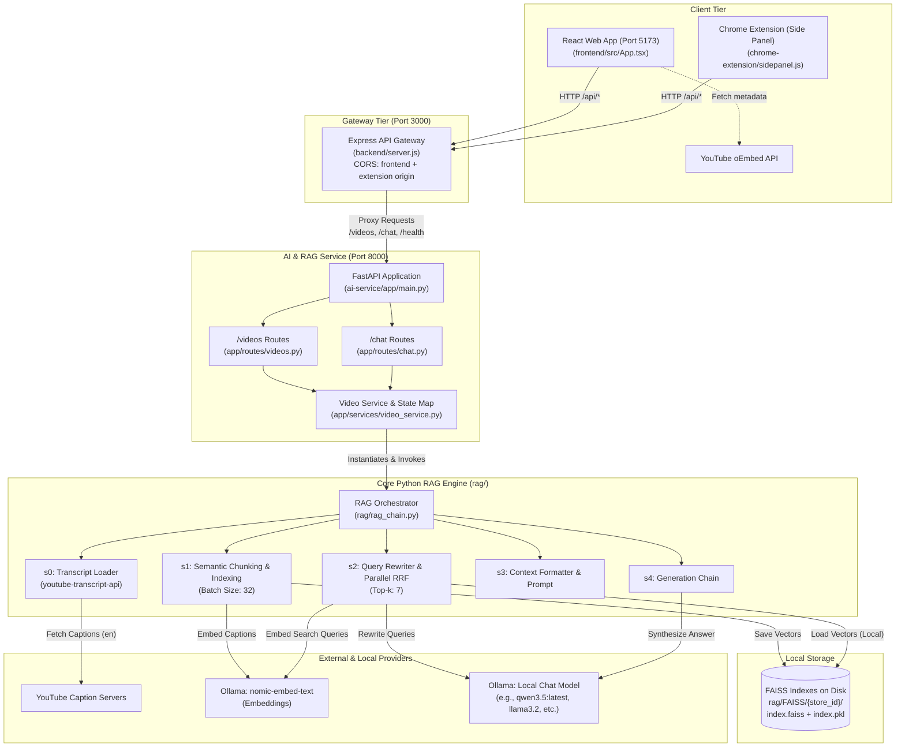

# YouTube RAG Assistant

A privacy-focused, local Retrieval-Augmented Generation (RAG) assistant that allows users to ask natural-language questions about YouTube videos and receive accurate, concise answers grounded strictly in available video caption transcripts, complete with timestamped source citations.

The project offers two user experiences powered by the same backend:
1. **Interactive Web Application**: A full-featured React 19 + Vite dashboard for managing session videos and conversations.
2. **Chrome Extension (Side Panel)**: A Manifest V3 Chrome extension that sits alongside your YouTube tabs as a native side panel, automatically detecting videos and letting you chat without leaving the video page.

---

## Table of Contents

- [Overview](#overview)
- [Product Purpose & Boundaries](#product-purpose--boundaries)
- [Key Features](#key-features)
- [System Architecture](#system-architecture)
- [End-to-End Data Flow](#end-to-end-data-flow)
- [Repository Structure](#repository-structure)
- [Technology Stack](#technology-stack)
- [Prerequisites & Model Setup](#prerequisites--model-setup)
  - [1. Install and Start Ollama](#1-install-and-start-ollama)
  - [2. Pull Default Models](#2-pull-default-models)
  - [3. Customizing / Changing the Model in `rag_chain.py`](#3-customizing--changing-the-model-in-rag_chainpy)
- [Installation & Setup](#installation--setup)
  - [1. Python Virtual Environment (`/`)](#1-python-environment-setup-root)
  - [2. Express Backend Setup (`backend/`)](#2-express-backend-setup-backend)
  - [3. React Frontend Setup (`frontend/`)](#3-frontend-setup-frontend)
  - [4. Chrome Extension Configuration (`chrome-extension/`)](#4-chrome-extension-setup-chrome-extension)
- [Running the Application Locally](#running-the-application-locally)
  - [Service Execution Summary](#service-execution-summary)
  - [Terminal 1: FastAPI AI Service](#terminal-1--running-the-fastapi-ai-service)
  - [Terminal 2: Express Gateway Backend](#terminal-2--running-the-express-gateway-backend)
  - [Option A: Running the React Web Client](#option-a--running-the-react-web-client)
  - [Option B: Loading the Chrome Extension](#option-b--loading-the-chrome-extension-side-panel)
  - [Option C: Standalone Terminal CLI](#option-c--running-the-standalone-rag-cli)
- [API Reference](#api-reference)
  - [FastAPI AI Service (`:8000`)](#fastapi-ai-service-http1270018000)
  - [Express Application Gateway (`:3000`)](#express-application-gateway-httplocalhost3000)
- [RAG Pipeline Deep Dive](#rag-pipeline-deep-dive)
  - [1. Transcript Loading & ID Parsing](#1-transcript-loading--video-id-extraction)
  - [2. Semantic Boundary Chunking](#2-semantic-boundary-chunking-heuristic)
  - [3. Multi-Query Rewriting & Parallel Retrieval](#3-multi-query-rewriting--parallel-retrieval)
  - [4. Reciprocal Rank Fusion (RRF)](#4-reciprocal-rank-fusion-rrf-re-ranking)
  - [5. Grounded Generation](#5-grounded-answer-generation)
- [Persistence & Lifecycle Management](#persistence--lifecycle-management)
- [Implementation Status](#implementation-status)
- [Limitations & Security Considerations](#limitations--security-considerations)
- [License](#license)

---

## Overview

**YouTube RAG Assistant** indexes YouTube video captions into a local vector store and uses locally hosted large language models to answer questions about the video content. The system preserves precise timestamps for all retrieved caption chunks, enabling users to verify answers and jump directly to the exact moments in the video where topics are discussed.

The application is structured into a clean service-oriented architecture:
1. **Python RAG Pipeline & FastAPI Service (`ai-service/`, `rag/`)**: Handles transcript retrieval, semantic chunking, embedding generation, FAISS indexing, query rewriting, and LLM generation via Ollama.
2. **Express API Gateway (`backend/`)**: Acts as the backend API proxy for client applications, managing CORS for both the web app and the Chrome extension, and decoupling client consumers from AI service internals.
3. **Clients**:
   - **React + Vite Web App (`frontend/`)**: Modern responsive web UI with oEmbed video preview cards, session persistence, and collapsible source citations.
   - **Chrome Extension (`chrome-extension/`)**: Manifest V3 extension opening in the Chrome side panel, providing active-tab video detection, separate pending video tracking, and in-place Q&A while watching YouTube.

---

## Product Purpose & Boundaries

To set correct expectations, it is essential to understand what the system does and what it deliberately does not do:

### What It Does
- **URL Parsing**: Accepts standard YouTube URLs (`youtube.com/watch?v=...`), shortened links (`youtu.be/...`), Shorts (`youtube.com/shorts/...`), and embed links.
- **Caption Fetching**: Downloads existing English caption tracks (manual or auto-generated) via `youtube-transcript-api`.
- **Semantic Chunking**: Breaks caption transcripts into coherent, timestamp-aware chunks using cosine distance heuristics between neighboring caption embeddings combined with duration boundaries (20s–60s).
- **Local Embedding & Indexing**: Generates vector representations with `nomic-embed-text` and persists FAISS vector stores locally on disk.
- **Query Rewriting & RRF**: Generates alternative search queries and merges search results using Reciprocal Rank Fusion (RRF) for enhanced retrieval coverage.
- **Strictly Grounded Answers**: Generates answers via local LLMs using only the retrieved transcript context, declining to answer when the captions lack sufficient information.
- **Timestamped Sources**: Returns exact start and end timestamps alongside caption text so users can verify statements and jump straight to the video timestamp.

### What It Does NOT Do
- **Does NOT watch or analyze video frames**: It has no computer vision capabilities and cannot see visual demonstrations, slides, diagrams, or on-screen text not read aloud.
- **Does NOT perform speech-to-text (STT)**: It does not download video audio or transcribe spoken words with Whisper or other speech models. If a video does not have an available English caption track on YouTube, it cannot be indexed.
- **Does NOT bypass YouTube restrictions**: Age-restricted, private, or regional-restricted videos without accessible public captions will fail during ingestion.
- **Does NOT use external cloud LLM APIs**: All embeddings and chat completions execute locally via Ollama without sending data to third-party AI providers.

---

## Key Features

- **100% Local Inference**: Runs entirely on your local machine using Ollama (`qwen3.5:latest` by default for generation/rewriting and `nomic-embed-text` for vector embeddings). You can switch models with a one-line change.
- **Dual Client Interfaces**:
  - **Chrome Side Panel**: Lives directly inside Chrome next to your video tab; automatically senses the YouTube video you are watching and allows chatting without switching tabs.
  - **Full Web Dashboard**: Clean React 19 UI with video history, status tracking, and thumbnail previews.
- **Intelligent Tab & Video Tracking in Extension**:
  - Listens for tab switching and URL changes in real time.
  - Distinguishes between the *active chat video* and a *detected pending video*, offering an "Index new video" toggle in the header without interrupting ongoing conversations.
- **Intelligent Semantic Chunking**: Rather than splitting transcripts strictly by arbitrary token counts, chunks are created by evaluating cosine semantic distance across adjacent caption segments combined with duration constraints (20s–60s).
- **Multi-Query Reciprocal Rank Fusion (RRF)**: Rewrites user questions into two alternative semantic variants, queries the FAISS index for all three simultaneously, and aggregates candidates using weighted RRF (4:1:1 weighting).
- **Timestamp Preservation**: Every document chunk retains `video_id`, `start`, and `end` metadata in seconds, surfaced to the user interface as direct links (`https://youtube.com/watch?v=VIDEO_ID&t=SECONDS`).
- **Per-Video FAISS Persistence**: Stores vector indices in distinct subdirectories named by the video's SHA-256 hash prefix (`rag/FAISS/<hash>/`), avoiding redundant re-indexing across sessions.
- **Non-Blocking Background Indexing**: Video submission returns HTTP `202 Accepted` immediately, delegating vectorization to background tasks while the client polls for readiness.

---

## System Architecture



### Layer Responsibilities

| Component | Directory | Responsibilities |
|---|---|---|
| **Chrome Extension** | `chrome-extension/` | Manifest V3 side panel interface. Senses active tab YouTube URLs, provides smooth switching between detected and chatting videos, triggers indexing, polls status, and streams chat with collapsible timestamp sources. |
| **Frontend Web App** | `frontend/` | React 19 web app with oEmbed preview cards, multi-video session list, animated thinking states, and chat view. |
| **Backend Gateway** | `backend/` | Express.js reverse proxy on port 3000. Reads `chrome-extension/.env` and environment variables for CORS, forwards `/api/*` to the AI service on port 8000, and normalizes errors. |
| **AI Service** | `ai-service/` | FastAPI application exposing `/videos`, `/videos/{id}/status`, and `/chat`. Runs indexing tasks asynchronously in background threads. |
| **RAG Engine** | `rag/` | Core LangChain pipelines: URL parsing, caption fetching, 90th percentile semantic distance chunking, FAISS persistence, multi-query expansion, and grounded generation. |
| **Vector Store** | `rag/FAISS/` | On-disk directory storing vector embeddings (`index.faiss`) and serialized document chunks (`index.pkl`). |

---

## End-to-End Data Flow

### 1. Ingestion & Indexing Flow

```text
1. User submits YouTube URL (via Web UI or clicking "Index captions" in Chrome Side Panel)
2. Client sends POST /api/videos to Express Gateway (:3000)
3. Express proxies request to POST /videos on FastAPI AI Service (:8000)
4. FastAPI extracts video ID:
   - If index already in memory: returns 200 OK {"status": "ready"}
   - If currently indexing: returns 202 Accepted {"status": "processing"}
   - If new: creates state {"status": "processing"}, spawns background task, returns 202 Accepted
5. Background worker invokes RAG(youtube_url):
   a. Computes store_id = SHA256(video_id)[:16]
   b. Checks disk for rag/FAISS/<store_id>/
   c. If exists on disk: reloads index into memory (re-embedding skipped)
   d. If NOT on disk:
      - Fetches English transcript segments via youtube-transcript-api
      - Embeds caption segments in batches of 32 via nomic-embed-text
      - Detects topic boundaries (cosine distance >= 90th percentile and duration >= 20s, or hard limit >= 60s)
      - Creates LangChain Document chunks with 2-caption overlap and timestamps
      - Saves FAISS index to disk under rag/FAISS/<store_id>/
6. Video status transitions to "ready". Client polling receives "ready" and unlocks the question input.
```

### 2. Question Answering Flow

```text
1. User types question and hits Enter -> sends POST /api/chat
2. Express forwards request to POST /chat on FastAPI (:8000)
3. FastAPI invokes the RAG pipeline:
   a. Query Rewriting: Generates 2 alternate search queries with Ollama (temp=0.7)
   b. Parallel Retrieval: Retrieves top-7 chunks for all 3 queries from FAISS
   c. Reciprocal Rank Fusion: Merges and re-ranks documents with 4:1:1 weighting
   d. Context Assembly: Formats top-7 unique chunks with [start to end] timestamps
   e. Generation: LLM (temp=0.2) synthesizes concise answer strictly from context
4. FastAPI returns { answer, url, video_id, sources: [{ start, end, text }] }
5. Express proxies response back to client
6. Client renders answer bubble and expandable source cards with clickable timestamp links
```

---

## Repository Structure

```text
Youtube-RAG-assistant/
├── .gitignore                      # Git exclusion rules (venv, node_modules, local indexes)
├── requirements.txt                # Python package dependencies
│
├── ai-service/                     # FastAPI AI Service (Port 8000)
│   ├── app/
│   │   ├── routes/
│   │   │   ├── chat.py             # POST /chat route and response handling
│   │   │   └── videos.py           # POST /videos & GET /videos/{video_id}/status routes
│   │   ├── services/
│   │   │   └── video_service.py    # In-memory status map, RAG instance cache & background worker
│   │   ├── main.py                 # FastAPI application initialization & /health route
│   │   └── schemas.py              # Pydantic request & response validation schemas
│
├── backend/                        # Express API Gateway (Port 3000)
│   ├── package.json                # Express, CORS, and dotenv dependencies
│   ├── package-lock.json
│   └── server.js                   # Reverse proxy, CORS allowlist & AI service forwarding
│
├── chrome-extension/               # Chrome Extension Side Panel (Manifest V3)
│   ├── .env                        # Local CHROME_EXTENSION_ORIGIN config (not committed)
│   ├── background.js               # Service worker: opens side panel on toolbar icon click
│   ├── manifest.json               # MV3 config: sidePanel, tabs, host permissions
│   ├── sidepanel.html              # Side panel UI layout & header toggle
│   ├── sidepanel.js                # Tab detection, indexing trigger, polling & chat
│   ├── style.css                   # Dark theme styling, bubbles & animations
│   └── icons/                      # App icons (16, 32, 48, 128 px)
│
├── frontend/                       # React 19 Client UI (Port 5173)
│   ├── .env.local                  # Local frontend environment config (VITE_API_BASE_URL)
│   ├── package.json                # React, Vite, Tailwind CSS dependencies & scripts
│   ├── vite.config.ts              # Vite configuration with React and Tailwind plugins
│   └── src/
│       ├── App.tsx                 # Core UI component: video strip, oEmbed card, chat & sources
│       ├── services/api.ts         # Client API wrapper (fetch calls to backend /api/*)
│       └── types/api.ts            # TypeScript interfaces for API requests/responses
│
└── rag/                            # Core Python RAG Pipeline
    ├── FAISS/                      # Disk persistence directory for FAISS vector indexes
    │   └── <store_id>/             # Per-video folders containing index.faiss and index.pkl
    ├── steps/
    │   ├── s0_load_transcript.py   # URL parsing, store_id generation & caption fetching
    │   ├── s1_indexing.py          # Semantic boundary chunking & FAISS index creation
    │   ├── s2_retriever.py         # Query rewriting, parallel search & Reciprocal Rank Fusion
    │   ├── s3_augmentation.py      # Context string formatter & grounding prompt template
    │   ├── s4_generation.py        # Standalone testing harness for retrieval & generation
    │   └── schemas.py              # Pydantic schema for structured query rewrites
    ├── main.py                     # Interactive CLI entrypoint for terminal testing
    └── rag_chain.py                # Unified RAG class orchestrating ingestion, retrieval & chat
```

---

## Technology Stack

| Layer | Technology | Version | Purpose |
|---|---|---|---|
| **LLM & Embeddings** | [Ollama](https://ollama.com/) | Local Daemon | Host local open-weights models (`qwen3.5:latest`, `nomic-embed-text`) |
| **RAG Framework** | [LangChain](https://www.langchain.com/) | `^1.4.6` | Composition of Runnables, prompt templating, and output parsers |
| **Vector Storage** | [FAISS CPU](https://github.com/facebookresearch/faiss) | `^1.15.1` | Local vector similarity indexing and on-disk serialization |
| **Captions** | [youtube-transcript-api](https://github.com/jdepoix/youtube-transcript-api) | `^1.2.4` | Downloading public and automated YouTube transcript tracks |
| **AI Web Framework**| [FastAPI](https://fastapi.tiangolo.com/) | `^0.162.0` | Asynchronous REST API exposing indexing and chat endpoints |
| **ASGI Server** | [Uvicorn](https://www.uvicorn.org/) | `^0.54.0` | Running the FastAPI service with reload support |
| **API Gateway** | [Express](https://expressjs.com/) | `^5.3.0` | Node.js reverse proxy, CORS enforcement, and client facade |
| **Chrome Extension**| Vanilla JS / HTML / CSS | Manifest V3 | Browser side panel with tabs permission and dynamic video sensing |
| **Web UI** | [React](https://react.dev/) | `^19.3.1` | Component-based interface with native React Compiler support |
| **Styling** | [Tailwind CSS](https://tailwindcss.com/) | `^4.3.3` | Utility-first styling with the modern `@tailwindcss/vite` plugin |

---

## Prerequisites & Model Setup

Before running the application, make sure your development environment has:
1. **Python**: Version `3.11` to `3.13`.
2. **Node.js**: Version `18.x` or higher (Node 20+ LTS recommended).
3. **Ollama**: Installed and running locally.
4. **Google Chrome** (or Chromium-based browser): For the Chrome Extension side panel.

---

### 1. Install and Start Ollama

Download Ollama from [ollama.com](https://ollama.com/download) and verify the daemon is running:

```powershell
ollama --version
```

---

### 2. Pull Default Models

The application out-of-the-box is configured to use `nomic-embed-text` for embeddings and `qwen3.5:latest` for generation and query rewriting:

```powershell
# 1. Text embedding model for transcript chunks and search queries
ollama pull nomic-embed-text

# 2. Chat model for structured query rewriting and final answer synthesis
ollama pull qwen3.5:latest
```

Verify installed models:

```powershell
ollama list
```

---

### 3. Customizing / Changing the Model in `rag_chain.py`

You can easily change the LLM used for answering questions and query rewriting to any model supported by Ollama (such as `llama3.2`, `mistral`, `gemma2`, `qwen2.5`, etc.).

#### Step 1: Pull the model you want to use
```powershell
# Example: pull llama3.2 or mistral
ollama pull llama3.2:latest
```

#### Step 2: Update `rag/rag_chain.py`
Open `rag/rag_chain.py` and locate lines 77–88 in the `__init__` constructor:

```python
# Before:
self.llm = ChatOllama(
    model="qwen3.5:latest",
    temperature=0.2,
    reasoning=False,
)

self.rewrite_llm = ChatOllama(
    model="qwen3.5:latest",
    temperature=0.7,
    reasoning=False,
)
```

Change the `model` parameter to your preferred model name:

```python
# After (Example using llama3.2):
self.llm = ChatOllama(
    model="llama3.2:latest",
    temperature=0.2,
    reasoning=False,
)

self.rewrite_llm = ChatOllama(
    model="llama3.2:latest",
    temperature=0.7,
    reasoning=False,
)
```

Save the file. When Uvicorn is running with `--reload`, it will automatically reload with the new model.

> [!NOTE]
> **Changing the Embedding Model**: The embedding model is defined as `nomic-embed-text` in `rag/steps/s1_indexing.py` and `rag/steps/s2_retriever.py`. If you change the embedding model, be sure to delete or re-index existing stores under `rag/FAISS/`, because vector dimensions and representations differ across embedding models.

---

## Installation & Setup

Clone the repository and prepare each service environment:

```powershell
git clone <repository-url>
cd Youtube-RAG-assistant
```

### 1. Python Environment Setup (Root)

Create and activate a virtual environment, then install Python packages:

```powershell
# Create virtual environment
python -m venv .venv

# Activate virtual environment
# On Windows (PowerShell):
.venv\Scripts\Activate.ps1
# On Linux / macOS:
# source .venv/bin/activate

# Upgrade pip and install dependencies
python -m pip install --upgrade pip
pip install -r requirements.txt
pip install youtube-transcript-api
```

> [!NOTE]
> `youtube-transcript-api` is required by `rag/steps/s0_load_transcript.py` to retrieve YouTube captions.

---

### 2. Express Backend Setup (`backend/`)

Open a new terminal or navigate to `backend/`:

```powershell
cd backend
npm install
```

---

### 3. Frontend Setup (`frontend/`)

Navigate to `frontend/` and install dependencies:

```powershell
cd frontend
npm install
```

Verify that `frontend/.env.local` contains:
```env
VITE_API_BASE_URL=http://localhost:3000/api
```

---

### 4. Chrome Extension Setup (`chrome-extension/`)

The Chrome extension communicates with the Express gateway at `http://localhost:3000`. To allow your Chrome extension to make CORS requests to Express:

1. Create a `.env` file inside `chrome-extension/` (do not commit this file):
   ```env
   CHROME_EXTENSION_ORIGIN=chrome-extension://YOUR_EXTENSION_ID
   ```
2. You will obtain `YOUR_EXTENSION_ID` after loading the unpacked extension in Chrome (detailed below).

---

## Running the Application Locally

### Service Execution Summary

The backend services (FastAPI and Express) must be running for either the Chrome Extension or the Web UI to work.

| Process | Working Directory | Command | URL |
|---|---|---|---|
| **Ollama Daemon** | Anywhere | `ollama serve` (or system tray) | `http://127.0.0.1:11434` |
| **FastAPI AI Service** | Root (`/`) | `python -m uvicorn app.main:app --app-dir ai-service --reload --port 8000` | `http://127.0.0.1:8000` |
| **Express Gateway** | `backend/` | `npm start` | `http://localhost:3000` |
| **Client 1: Chrome Extension** | Chrome Browser | Load unpacked from `chrome-extension/` | Chrome Side Panel |
| **Client 2: Web Frontend** | `frontend/` | `npm run dev` | `http://localhost:5173` |

---

### Terminal 1 — Running the FastAPI AI Service

From the **repository root**, with your virtual environment active:

```powershell
.venv\Scripts\Activate.ps1
python -m uvicorn app.main:app --app-dir ai-service --reload --port 8000
```

- **Health check**: `http://127.0.0.1:8000/health`
- **Interactive Swagger Docs**: `http://127.0.0.1:8000/docs`

> [!IMPORTANT]
> The AI service must be started from the repository root with `--app-dir ai-service` so Python can resolve both the `app` package and the `rag` package.

---

### Terminal 2 — Running the Express Gateway Backend

From the `backend/` directory:

```powershell
cd backend
npm start
```

The Express server will launch on port `3000`:
```text
Express server listening on http://localhost:3000
```

- **Gateway Health**: `http://localhost:3000/health`
- **AI Connectivity**: `http://localhost:3000/api/ai-health`

---

### Option A — Running the React Web Client

From the `frontend/` directory:

```powershell
cd frontend
npm run dev
```

Open your browser to `http://localhost:5173`. You can paste any YouTube URL, wait for background indexing to complete, and chat with timestamp citations.

---

### Option B — Loading the Chrome Extension (Side Panel)

This enables the companion side panel directly inside your Chrome browser:

1. Open Google Chrome and navigate to `chrome://extensions`.
2. Toggle on **Developer mode** in the top-right corner.
3. Click the **Load unpacked** button in the top-left.
4. Select the `chrome-extension` directory from this repository:
   ```text
   C:\B.TECH\Personal Projects\Langchain\Youtube-RAG-assistant\chrome-extension
   ```
5. Note the generated **Extension ID** displayed on the extension card (e.g. `nfmccjfeicdcnbdhknkjbpaodggephdc`).
6. Set this ID in `chrome-extension/.env`:
   ```env
   CHROME_EXTENSION_ORIGIN=chrome-extension://YOUR_EXTENSION_ID
   ```
   *(Restart the Express backend in Terminal 2 so it picks up the updated origin).*
7. Click the **puzzle piece (Extensions)** icon in Chrome's toolbar and **pin** the **YouTube RAG Assistant** icon.
8. Navigate to any YouTube video (e.g. `https://www.youtube.com/watch?v=...`).
9. Click the pinned **YouTube RAG Assistant** toolbar icon. The side panel opens immediately on the right side of the screen!
10. Click **Index captions**. Once indexing reports ready, type your question and press **Enter** (use **Shift+Enter** for newlines).
11. **Tab & Navigation Sensing**: If you switch tabs or navigate to another YouTube video, an **"Index new video"** button appears in the top right. Your active conversation stays intact until you choose to index the new video!

---

### Option C — Running the Standalone RAG CLI

You can also run the RAG pipeline directly in your terminal without starting the web servers:

```powershell
# From the repository root with virtual environment activated:
python -m rag.main
```

Type or paste a YouTube URL. Once initialized, an interactive prompt lets you ask questions or type `exit` to quit.

---

## API Reference

### FastAPI AI Service (`http://127.0.0.1:8000`)

#### 1. Health Check
- **Method**: `GET`
- **Path**: `/health`
- **Response (200 OK)**:
```json
{
  "status": "ok",
  "service": "youtube-rag-api"
}
```

---

#### 2. Submit Video for Indexing
- **Method**: `POST`
- **Path**: `/videos`
- **Request Body**:
```json
{
  "url": "https://www.youtube.com/watch?v=XZ0PMRWXBEU"
}
```
- **Responses**:
  - `200 OK` (Video was already indexed and is ready in memory):
    ```json
    {
      "video_id": "XZ0PMRWXBEU",
      "status": "ready"
    }
    ```
  - `202 Accepted` (Video indexing started in background or is in progress):
    ```json
    {
      "video_id": "XZ0PMRWXBEU",
      "status": "processing"
    }
    ```
  - `422 Unprocessable Entity` (Invalid URL or no video ID found):
    ```json
    {
      "detail": "The URL does not contain a valid YouTube video ID."
    }
    ```

---

#### 3. Check Video Status
- **Method**: `GET`
- **Path**: `/videos/{video_id}/status`
- **Responses**:
  - `200 OK` (Ready):
    ```json
    {
      "video_id": "XZ0PMRWXBEU",
      "status": "ready",
      "message": "The video is ready for questions"
    }
    ```
  - `200 OK` (Processing):
    ```json
    {
      "video_id": "XZ0PMRWXBEU",
      "status": "processing",
      "message": "The transcript is being indexed."
    }
    ```
  - `200 OK` (Failed):
    ```json
    {
      "video_id": "XZ0PMRWXBEU",
      "status": "failed",
      "message": "The video could not be indexxed. Check the API logs for details."
    }
    ```
  - `404 Not Found` (Video not submitted in current session):
    ```json
    {
      "detail": "This video has not been submitted for indexing in this API session."
    }
    ```

---

#### 4. Ask a Question (Chat)
- **Method**: `POST`
- **Path**: `/chat`
- **Request Body**:
```json
{
  "video_id": "XZ0PMRWXBEU",
  "question": "What is the main topic covered in this video?"
}
```
- **Responses**:
  - `200 OK`:
    ```json
    {
      "answer": "The speaker introduces the core principles of retrieval-augmented generation and explains vector similarity search.",
      "url": "https://www.youtube.com/watch?v=XZ0PMRWXBEU",
      "video_id": "XZ0PMRWXBEU",
      "sources": [
        {
          "start": 5.839,
          "end": 36.239,
          "text": "welcome everyone in this session we are going to explore how RAG architectures function..."
        },
        {
          "start": 42.12,
          "end": 78.45,
          "text": "first we take our documents and convert them into dense vector embeddings..."
        }
      ]
    }
    ```
  - `404 Not Found`:
    ```json
    {
      "detail": "This video has not been submitted during this API session."
    }
    ```
  - `409 Conflict` (Still indexing):
    ```json
    {
      "detail": "This video is still being indexed. Try again when its status is ready."
    }
    ```
  - `422 Unprocessable Entity` (Empty or blank question string):
    ```json
    {
      "detail": [
        {
          "loc": ["body", "question"],
          "msg": "Value error, Question cannot be blank.",
          "type": "value_error"
        }
      ]
    }
    ```
  - `503 Service Unavailable` (Indexing failed or RAG instance unavailable):
    ```json
    {
      "detail": "The video could not be indexxed. Check the API logs for details."
    }
    ```

---

### Express Application Gateway (`http://localhost:3000`)

The Express gateway forwards requests to the FastAPI AI service and handles CORS for both Web and Chrome Extension clients.

| Method | Express Route | Forwarded Target | Description |
|---|---|---|---|
| `GET` | `/health` | *Handled locally* | Returns `{ "status": "ok" }` |
| `GET` | `/api/ai-health` | `GET http://127.0.0.1:8000/health` | Verifies Express-to-FastAPI connectivity |
| `POST` | `/api/videos` | `POST http://127.0.0.1:8000/videos` | Forwards video URL submission |
| `GET` | `/api/videos/:videoId/status` | `GET http://127.0.0.1:8000/videos/{videoId}/status` | Forwards status check |
| `POST` | `/api/chat` | `POST http://127.0.0.1:8000/chat` | Forwards question and returns answers with sources |

#### Gateway Error Handling
- **AI Service Down**: If the FastAPI service is not reachable, Express returns an HTTP `502 Bad Gateway`:
  ```json
  {
    "status": "error",
    "message": "Could not reach the AI service."
  }
  ```
- **Malformed JSON**: If the client sends an invalid JSON payload, Express catches the syntax error and returns HTTP `400 Bad Request`:
  ```json
  {
    "detail": "Request body must be valid JSON."
  }
  ```

---

## RAG Pipeline Deep Dive

### 1. Transcript Loading & Video ID Extraction

In `rag/steps/s0_load_transcript.py`:
- Extracts video IDs using URL parsing:
  - Shortened URLs: `youtu.be/{video_id}`
  - Standard watch URLs: `youtube.com/watch?v={video_id}`
  - Shorts URLs: `youtube.com/shorts/{video_id}`
  - Embed URLs: `youtube.com/embed/{video_id}`
- Generates a deterministic directory key:
  $$\text{store\_id} = \text{SHA256}(\text{video\_id})[:16]$$
- Fetches transcript segments using `YouTubeTranscriptApi().fetch(video_id, languages=["en"])`. Each segment includes `text`, `start` (in seconds), and `duration` (in seconds).

---

### 2. Semantic Boundary Chunking Heuristic

In `rag/steps/s1_indexing.py`:
Instead of fixed-character splitting, the pipeline uses semantic topic detection:
1. **Batch Caption Embedding**: Caption segments are embedded in batches of 32 using `nomic-embed-text` to avoid overloading Ollama.
2. **Cosine Distance**: Computes the cosine distance between consecutive captions:
   $$\text{distance}(a, b) = 1 - \frac{a \cdot b}{\|a\|_2 \|b\|_2}$$
3. **Adaptive Threshold**: Computes the 90th percentile of distance shifts across the entire video:
   $$\text{threshold} = \text{sorted}(\text{distances})[\lfloor 0.9 \times (\text{len} - 1) \rfloor]$$
4. **Boundary Decision**: A split occurs if:
   - Meaning changed ($\text{distance} \ge \text{threshold}$) **and** chunk duration $\ge 20$ seconds, **OR**
   - Chunk duration reaches the hard limit of $60$ seconds.
5. **Caption Overlap**: Consecutive chunks preserve context continuity by including the last 2 caption segments from the preceding chunk (`chunk_start = max(i - 2, chunk_start + 1)`).
6. **Metadata**: Each chunk is stored as a LangChain `Document` preserving `video_id`, `start`, and `end = start + duration`.
7. **Storage**: Vectors are added to FAISS in batches of 32 and saved to `rag/FAISS/<store_id>/`.

---

### 3. Multi-Query Rewriting & Parallel Retrieval

In `rag/steps/s2_retriever.py`:
A common failure mode in caption RAG is vocabulary mismatch (the question uses different terms than the conversational transcript). To overcome this:
- An LLM stage (`ChatOllama(model="...", temperature=0.7)`) receives the original question and generates **two alternative search queries** using different vocabulary while preserving intent.
- Output is enforced via Pydantic structured output (`QuestionRewrites(rewrite_1, rewrite_2)`).
- The pipeline executes similarity search ($k=7$) in parallel using `RunnableParallel` across all three queries:
  - `question_1` (Original Question)
  - `question_2` (Alternative Phrasing 1)
  - `question_3` (Alternative Phrasing 2)

---

### 4. Reciprocal Rank Fusion (RRF) Re-ranking

In `rag/steps/s2_retriever.py`:
The retrieved candidate lists are merged using Reciprocal Rank Fusion with rank discount constant $c = 60$. To ensure high fidelity to the user's explicit intent, the original query receives a $4\times$ weighting:

$$\text{RRF Score}(d) = \sum_{q \in \{1, 2, 3\}} \frac{w_q}{60 + \text{rank}_q(d)}$$

Where:
- $w_1 = 4$ for the original query.
- $w_2 = 1, w_3 = 1$ for the two rewritten queries.
- Documents are deduplicated by `(video_id, start, end, text)`.
- The top $k=7$ highest-scoring chunks are retained for context injection.

---

### 5. Grounded Answer Generation

In `rag/steps/s3_augmentation.py` and `rag/rag_chain.py`:
- Context chunks are assembled into timestamp-annotated blocks:
  ```text
  [12.5s to 38.2s]
  transcript text excerpt...

  [45.0s to 75.3s]
  second transcript excerpt...
  ```
- Prompt instructions enforce strict factual boundaries:
  ```text
  You answer questions using YouTube transcript captions.

  Use only the transcript context below. If it does not contain enough information
  to answer the question, say that the transcript does not provide enough
  information. Do not make up details.

  Transcript context:
  {context}

  Question:
  {question}

  Give a concise answer. Do not include your private reasoning.
  ```
- **Inference**: Executed with `ChatOllama(model="...", temperature=0.2, reasoning=False)` to minimize hallucination and enforce concise responses without exposing internal thought tokens.

---

## Persistence & Lifecycle Management

Understanding how data persists across restarts is critical for administering the service:

### What Persists
- **FAISS Vector Indexes**: Written to disk at `rag/FAISS/<store_id>/` (`index.faiss` binary index and `index.pkl` docstore).
- When a video URL is submitted, `RAG.get_or_create_index()` checks whether the on-disk folder exists. If present, it reuses the precomputed vectors immediately and skips caption downloading and embedding.

### What Is Ephemeral (In-Memory)
- **FastAPI Video State**: `video_statuses` and `rag_instances` in `ai-service/app/services/video_service.py` are Python dictionaries held in memory.
  - If the FastAPI service restarts, in-memory state is cleared.
  - However, because the FAISS store persists on disk, re-submitting a previously indexed video URL will immediately detect the existing store, reload it into memory, and transition to `"ready"` in seconds without re-embedding.
- **Client State**:
  - **Web Client**: Persisted in `sessionStorage` (`youtube-rag-session-videos` and `youtube-rag-session-chats`).
  - **Chrome Extension**: Maintained in side panel state during the browser session. Tab navigation tracks pending vs. active video cleanly.

---

## Implementation Status

| Component | Status | Details |
|---|---|---|
| **Transcript Loading** | **Implemented & Verified** | Fetches English transcripts via `youtube-transcript-api`; supports standard, shortened, Shorts, and embed URLs. |
| **Semantic Chunking** | **Implemented & Verified** | 90th percentile cosine distance thresholding with 20s–60s window and 2-caption overlap. |
| **FAISS Persistence** | **Implemented & Verified** | Stores indices under `rag/FAISS/<hash>/`; reloads existing stores on demand. |
| **Multi-Query Rewriting & RRF**| **Implemented & Verified** | Structured rewriting with local Ollama models and $4:1:1$ weighted Reciprocal Rank Fusion. |
| **Grounded Generation** | **Implemented & Verified** | Low-temperature LLM generation conditioned strictly on retrieved context. |
| **FastAPI AI Service** | **Implemented & Verified** | Async endpoints (`/health`, `/videos`, `/videos/{id}/status`, `/chat`) with background tasks. |
| **Express API Gateway** | **Implemented & Verified** | Reverse proxy on port 3000 with CORS protection and error normalization. |
| **React 19 Web Client** | **Implemented & Verified** | Single-page UI with video sidebar, oEmbed metadata, status polling, chat turns, and source drawers. |
| **Chrome Extension (Side Panel)** | **Implemented & Verified** | Manifest V3 side panel with dynamic tab-activation & URL-change listeners, pending video toggle, and collapsible timestamp citations. |
| **Database / User Auth** | **Planned / Future Work** | Multi-user authentication and database persistence (e.g. SQLite/PostgreSQL) are not yet implemented. |
| **Multi-Language Captions**| **Planned / Future Work** | Current pipeline explicitly requests English captions (`languages=["en"]`). |
| **Speech-to-Text Fallback**| **Out of Scope** | Audio transcription (Whisper) is not planned in order to maintain a fast, lightweight local profile. |

---

## Limitations & Security Considerations

1. **Caption Availability**: If a creator has disabled captions or YouTube has not generated an automatic transcript, the video cannot be indexed.
2. **Language Constraint**: Only English caption tracks (`languages=["en"]`) are queried. Non-English videos will fail indexing unless English subtitles are provided.
3. **Pickle Deserialization**: In `rag/steps/s2_retriever.py`, FAISS loads indices using `allow_dangerous_deserialization=True`. Python's `pickle` library can execute arbitrary code if loading untrusted files. **Do not copy or load unverified FAISS directories from untrusted third parties into your `rag/FAISS/` folder.**
4. **Local Hardware Demands**: Query rewriting and answer synthesis run locally via Ollama. Performance and response latency depend directly on your machine's CPU/GPU capabilities.
5. **YouTube Scraping & Rate Limits**: Rapidly fetching dozens of transcripts in a short period may trigger temporary IP rate limits from YouTube's caption endpoint.
6. **Schema Naming Note**: The FastAPI chat schema exposes `url` (`https://www.youtube.com/watch?v={video_id}`), while the frontend client types define `video_url`. Both clients gracefully construct timestamp links using the video ID and source `start` seconds.

---

## License

No explicit open-source license has been specified for the root repository. In the absence of an open-source license, all rights remain reserved by the project author.
